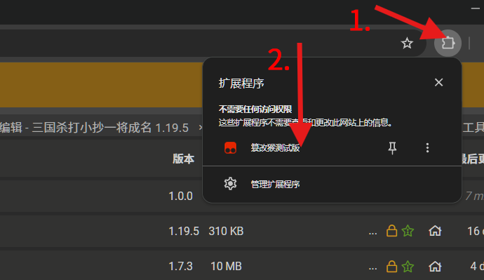
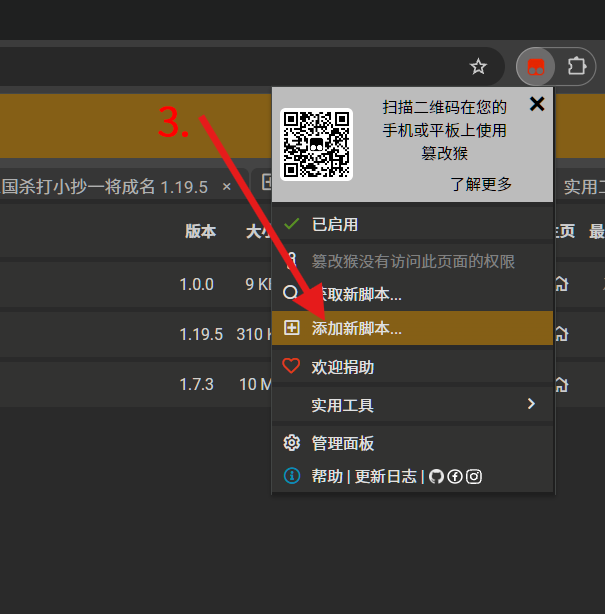
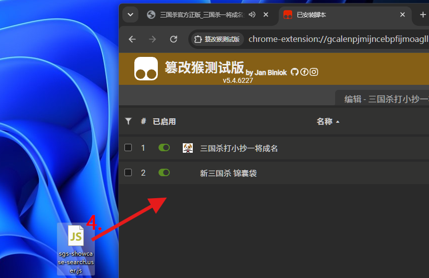
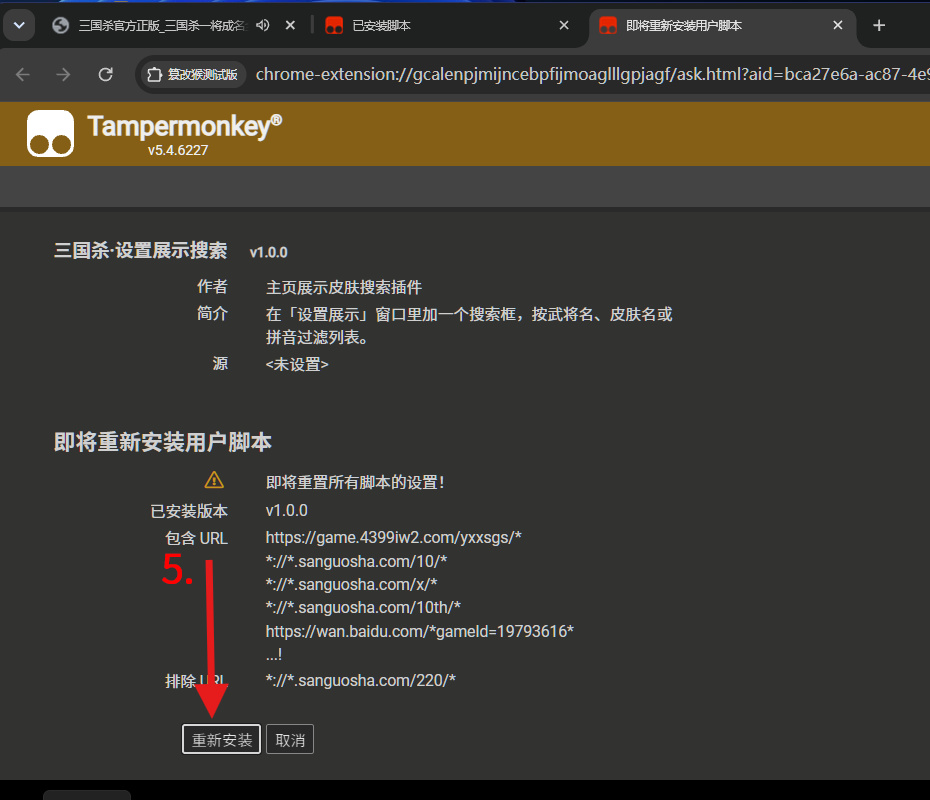
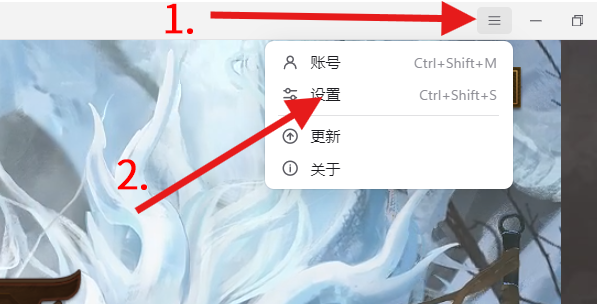
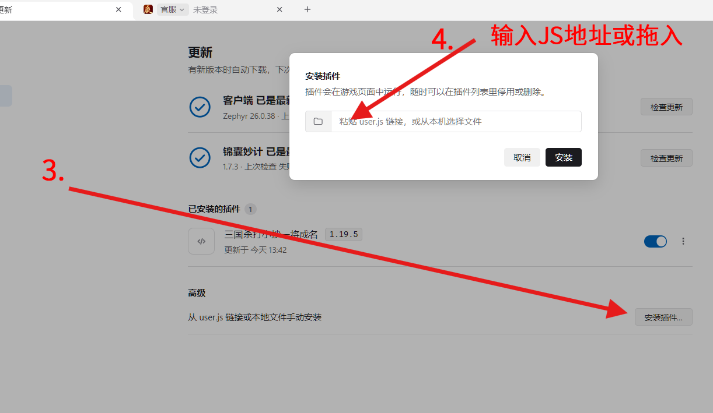

&nbsp;
&nbsp;
# 综合插件整合

> [!NOTE]
(๑•̀ㅂ•́)و✧ 把设置展示搜索、去红点、锦囊袋圆点、牌局屏蔽和 `/sound` 台词搜索打包进一个页签，台词**内置语音试听与发送**，不再需要额外的语音插件。**所有功能默认关闭**，想用哪个自己开。٩(ˊᗜˋ*)>

> [!WARNING]
>
> **--&nbsp;插件可选支持:**[锦囊妙计锦囊袋](https://github.com/Clarrycy/jinnangmiaoji)
>
> （使用前先看最后面的 <a href=#anchor_remind>==**小提醒&nbsp;·&nbsp;⚓**====(***特别是WARNING***)</a>)==

## （==<a href=#anchor_use>点击直接看使用教程&nbsp;·&nbsp;👈</a>==）

## 功能列表

- **设置展示搜索**：在「设置展示」窗口标题栏加搜索框，支持武将名、皮肤名、拼音连写，例如 `陆抗lukang`。
- **立即去红点 / 新标**：新弹出的界面基本下一帧就干净；**皮肤、武将界面的「新」会保留**。
- **锦囊袋圆点入口**：收起态只留一个 26px 圆点，点它仍然能正常展开锦囊袋，左右停靠都支持。
- **屏蔽对手发言**：牌局中不再显示其他玩家的普通聊天、快捷短语和表情。
- **屏蔽其他人皮肤特效**：其他座位的出框特效、技能皮肤特效、入场/登场特效都会被拦掉。
- **屏蔽其他人武将台词**：其他玩家的技能语音、死亡语音、入场语音和武将台词快捷短语都会被拦掉。
- **/sound 台词搜索**：按台词内容或武将名搜索，武将名匹配的结果排在最前；结果右侧带**对应皮肤头像**；显示条数可输入，外面面板默认 10 条、`/sound` 弹窗默认 50 条。大厅里点击 = 试听，牌局里点击 = 发送。
 - **快捷键截图**：面板最下面可以设一个**单键**快捷键（如 `F12`、`P`），按下时拦截该键的其他操作；**支持连拍**——快速连点每次都会抓一张，长按也会按 120ms 间隔持续拍，文件名带毫秒（`sgs_年月日_时分秒_毫秒.png`），同一秒多张也不会互相覆盖。截图音效收在一个**抽屉**里（点「截图音效」一行展开），共六个预设——**无 / 保存音 / 提示音 / 截图音 / 快门音 / 自定义**，默认「保存音」；四个内置音效都以 base64 直接内嵌在脚本里，离线也能响，需要自己的音频就点「自定义…」选本地文件。音效是**叠音**的：每张截图独立出声，连拍时上一声还没播完也不会被掐断（同时最多 12 个）。保存位置默认是电脑截图文件夹——**首次截图时选一次「图片\屏幕截图」授权**。
- **内置语音试听与发送**：每句台词右侧的 `▶` 按钮，点它预览这句台词的语音（大厅、牌局都能听）；牌局里点台词行则把语音发到聊天。播放与发送都由插件自己完成——**优先走游戏自带的台词发送接口**（`ChatManager.SendSkinChatPhrase`），锦囊袋语音发送 API 只作兜底，两条都不通时自动本地试听并提示。面板上会显示当前用的是哪条发送通道。
- >**值得注意的是锦囊袋是作为死亡语音和不符合模式的语音发送必要支持，部分武将存在国战版本所以部分武将点击国战版本只有有锦囊袋端的玩家才能听到，游戏原始语音通道仅支持普通武将语音（不含死亡）。**

  
## 代码实现

-  搜索框：包住「设置展示」皮肤/武将视图的 `UpdatePanel`，在 `DataProvider` 上按关键词过滤。
- 去红点：监视舞台节点和新增子节点，红点/「新」纹理直接换透明图；皮肤、武将相关窗口跳过「新」纹理。
- 圆点入口：收起时把原胶囊透明化并摘掉命中区，只留 26px 圆点接管点击，展开/收起仍走锦囊袋原生逻辑。
- 屏蔽聊天：在 `ChatManager` 解析消息前按「非自己 + 消息类型」拦掉牌局聊天。
- 屏蔽皮肤特效：游戏类原型是**不可扩展对象**，使用 `WeakMap` 存补丁状态；同时替换 `_events` 里已绑定的 `method`（单个对象或数组都处理），覆盖动态皮肤、技能皮肤、入场、登场、皮肤套装等入口。
- 屏蔽台词：直接拦 `PlayerSeat` 的技能语音、技能资源语音、死亡语音，再对入场/登场等 UI 方法做语音静音；锦囊袋自己的「听他人台词」也同步关闭。
- `/sound`：有锦囊袋目录时解压本地皮肤目录，建约 3 万条台词索引；没有目录时用游戏里当前武将的快捷台词。每条台词预先算好小写检索字段并缓存最近查询，搜索按“武将名 > 皮肤/技能 > 台词文本”加权排序；头像优先用台词所属皮肤资源，再回退到武将头像/默认皮肤。  ヽ(•̀ω•́ )ゝ
- 内置语音：试听直接走 `Laya.SoundManager.playSound` 播目录里的音频（切句时先 `stopSound` 上一句）；发送按「游戏原生台词发送 → 锦囊袋 `sendOfficialSkinPhrase` → 本地试听」三级降级。为了不依赖任何外部插件，游戏侧是这样找接口的：脚本启动时先给 `Laya.EventDispatcher.prototype.on/once` 挂一个探针，把游戏注册过事件的管理器实例都记下来，等于拿到一张对象索引表；再用「方法名打分」在表里找 `*SkinChatPhrase*` / `Send*Phrase` 这类方法，命中后按 `key` → `(key, text)` → `对象 {key, confId, dialogIndex, skinId}` 三种签名依次试。找不到时才退回浅层遍历全局对象与舞台节点（有节点上限，不会卡主线程）。当前用的是哪个对象、哪个方法，面板的「发送通道」一行会直接写出来。
- 截图：用 `Laya.stage.drawToCanvas(...).toBase64('image/png', 1)` 抓游戏画面；四个内置音效（保存音 / 提示音 / 截图音 / 快门音）以 base64 直接内嵌在脚本里，自定义音效才落 IndexedDB（`sgs-synthesize-media`）——音效、保存目录句柄都存在那里，重启后仍在。未选目录时首次截图会打开一次文件夹选择（默认定位到「图片」），授权后所有截图静默写入，不再弹「另存为」；环境不支持时退回浏览器下载。截图快捷键在 `keydown/keyup/keypress` 捕获阶段拦截，命中后阻止该键继续传给游戏。

## 面板的两种形态

在「综合」页签的「面板设置」里可以切换：

- **并入锦囊袋**：左侧列表里出现一个椭圆图标「综合」，位置在「插件」和「频道」之间。
- **独立面板**：锦囊袋里不再出现综合页签，屏幕左侧出现一个和锦囊袋圆点同尺寸的**白色小圆点**，点它展开/收起独立面板。

独立面板的标题栏和白色圆点都可以拖动，位置会记住。

还可以设置**展开/关闭快捷键**，默认没有。点快捷键按钮后按下组合键即可，例如 `Ctrl+Shift+K`；`Esc` 取消，`Backspace` 清除。

## 如何配置

>游戏里 个人信息 → 换展示 → 标题栏右侧搜索框；点 `×` 清空。
>>### 怎么安装与配置（默认已拥有插件）
>>&nbsp; 
>>**1.**
>>> **1.下载[tampermonkey](https://www.tampermonkey.net/)并确保其可用 （浏览器插件设置打开允许运行用户脚本）**
>>>
>>>**or 2. 下载[锦囊妙计客户端](https://github.com/Clarrycy/jinnangmiaoji)进行配置（<a href=#anchor_tutorial>教程👈</a>）**
>>>
>>>>**1.1**&nbsp;&nbsp;&nbsp;   &nbsp;&nbsp;**1.点击插件&nbsp;→&nbsp;2.点击篡改猴**
>>>>
>>>>**1.2**&nbsp;&nbsp;&nbsp;   &nbsp;&nbsp;**3.添加新脚本**
>>>>
>>>>**1.3**&nbsp;&nbsp;&nbsp;   &nbsp;&nbsp;**4.将js拖入篡改猴**
>>>>
>>>>**1.4**&nbsp;&nbsp;&nbsp;   &nbsp;&nbsp;**点击安装就完成了 · ✔️**
>>>&nbsp;
>>>&nbsp;
>>>>
>>>**2.锦囊妙计微端安装**
>>>>**2.1**&nbsp;&nbsp;&nbsp;   &nbsp;&nbsp;**1.点击≡**(抽屉) **→ 2.更新**
>>>>
>>>>**2.2**&nbsp;&nbsp;&nbsp;   &nbsp;&nbsp;**3.点击安装插件&nbsp;→&nbsp;4.载入JS就好啦&nbsp;&nbsp;(p≧w≦q)**
>&nbsp;
---

## 小提醒	

>[!TIP]
>>基于该项目上进行了自主开发及调试，可能使用此开源项目的部分代码。（[锦囊妙计客户端](https://github.com/Clarrycy/jinnangmiaoji)）&nbsp;(´･ω･`)
>
>脚本头部已写入 `@updateURL` / `@downloadURL`，篡改猴和锦囊妙计客户端的「检查更新」都能识别到新版本。
>
>牌局里发不出语音时，在控制台执行一次 `__SGS_SYN_DIAG__()`：它会打印当前通道、命中的对象与方法、已记录的游戏对象数量。把这段内容贴出来，就能判断是「没找到接口」还是「接口调用了但被拒绝」。

> [!WARNING]
>#### 一、非官方声明
>本插件由个人独立开发，与任何游戏官方、发行商、平台运营方无关联、无授权、无合作关系，不代表游戏官方立场，也未获得游戏官方的认可或背书。游戏中涉及的商标、版权及其他知识产权均归其各自权利人所有。
>
>
>#### 二、开源许可证与合规声明
>本插件在开发中使用了原项目的代码/资源，相关开源代码的著作权归原项目作者及其贡献者所有。
>
>
>如原项目许可证要求分发源码、相同方式共享、保留声明或提供修改说明，开发者应遵守相应义务。用户在使用本插件时，也应遵守原项目许可证及本插件许可证的约束。
>
>若本免责声明与原项目开源许可证存在冲突，就原项目代码部分而言，以原项目许可证为准。 本声明不构成对原项目许可证的修改或替代。
>
>#### 三、使用风险自担
>用户在使用本插件前，应自行了解所使用游戏平台的用户协议、插件政策及相关规定。是否使用本插件由用户自行判断并承担全部风险。
>
>因使用本插件可能导致的账号封禁、限制、数据丢失、虚拟财产损失、设备异常等后果，由用户自行承担，开发者不承担任何责任。
>
>本插件可能因游戏版本更新、平台政策调整、原项目停止维护等原因出现功能失效、兼容性问题或运行异常，开发者不保证插件的持续可用性、安全性或无错误运行。
>
>#### 四、免责条款
>在法律允许的最大范围内，开发者及原项目作者、贡献者均不对本插件作出任何明示或默示担保，包括但不限于适销性、特定用途适用性、不侵权及无错误的保证。因使用或无法使用本插件而产生的任何直接、间接、附带、特殊或后果性损失，开发者及原项目作者、贡献者均不承担赔偿责任。
>
>#### 五、知识产权与使用限制
>本插件中由开发者原创部分的著作权归开发者所有；原项目代码及资源的知识产权归其各自权利人所有。
>
>未经相应权利人许可，禁止对本插件进行反编译、逆向工程、恶意修改、二次分发或用于商业用途，但开源许可证明确允许的除外。
>
>用户不得利用本插件从事违反法律法规、侵犯他人权益、破坏游戏公平性或违反游戏平台规则的行为。
>
>#### 六、第三方内容
>本插件可能包含或调用第三方组件、库或服务，相关权利和责任由该第三方按其许可证或服务条款承担。开发者不对第三方内容的合法性、安全性作超出法律规定的保证。
>
>#### 七、条款变更与解释
>开发者保留随时修改本免责声明及插件功能的权力，修改后的条款自公布之日起生效。用户继续使用即视为接受变更后的条款。本声明由开发者负责解释，但不得违反适用法律及原项目开源许可证的强制性要求。
>
>#### 八、法律适用
>本声明适用[国家/地区]法律。因本声明引起的争议，双方应友好协商解决；协商不成的，提交[管辖地]有管辖权的机构处理。
>
>使用本插件即表示您已阅读、理解并同意上述全部条款。如不同意，请立即停止使用并删除本插件。
>
>#### 九、AI声明
> 项目使用人工智能辅助生成部分代码以及验证，包括但不限于部分`README.md`的文字、代码主体…
>
————————————————————————————————————————————————

>
<a href=#anchor_head>知道了</a>

&nbsp;
&nbsp;
&nbsp;
&nbsp;
&nbsp;

---

<a href="https://github.com/user7050030">© Tihaon7050030</a>

---